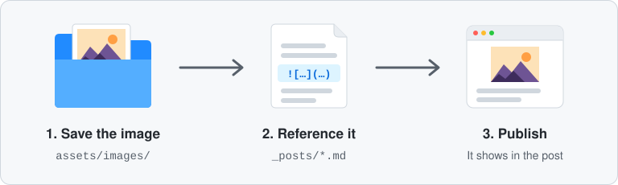

This is an example post. Replace it with your own writing, or remove this file
when you're ready to publish.

Posts are Markdown files in the `_posts` folder. Use the date in the filename
and add a title and date in the front matter above.

## Adding images

Image files live in the `assets/images` folder. The picture below is added
with Markdown image syntax:

To add a caption, use an HTML `figure` instead:

<figure>
  
  <figcaption>Save the image in <code>assets/images</code>, reference it from a post, and it appears on the published page.</figcaption>
</figure>
